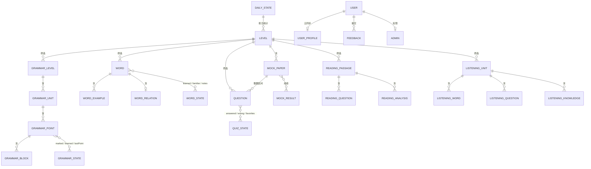

# 业务对象清单与数据字典

本文档列出樱花日语的**业务对象**（有业务含义、有生命周期、有唯一标识的数据实体），说明它们存在哪、谁读写、关键字段与不变量。

分四类：

| 类别 | 载体 | 可变性 | 说明 |
| --- | --- | --- | --- |
| A. 静态内容对象 | `src/data/*.js`，随安装包分发 | 只读 | 教材整理成果（词、文法、题库、读解、听解），由脚本生成 |
| B. 用户状态对象 | 浏览器 localStorage | 可写 | 学习进度与偏好，单设备生效，登录后部分参与云同步 |
| C. 云端对象 | Supabase（Postgres） | 可写 | 跨设备同步与运营数据（用户档案、反馈、管理员） |
| D. 运行时对象 | 内存 | 瞬时 | 由 A+B 派生（当前试卷、同步状态、更新状态等），不落盘 |

---

## 1. 总览

| # | 对象 | 类别 | 唯一标识 | 数量级 | 读写方 |
| --- | --- | --- | --- | --- | --- |
| O-01 | Level（等级） | A | `id`：`N5/N4/N3/N2/N1` | 5 | 全局筛选 |
| O-02 | GrammarLevel（文法册） | A | `id` | 5 | 文法模块 |
| O-03 | GrammarUnit（文法单元） | A | `id`，如 `N5-u1` | 26 | 文法模块 |
| O-04 | GrammarPoint（文法点） | A | `id`，如 `N5-1` | 801 | 阅读器 / 进度 |
| O-05 | GrammarBlock（文法内容块） | A（内嵌） | 数组下标 | 约 5 000+ | 渲染 |
| O-06 | Word（单词） | A | `id`（全局自增整数） | 7 200 | 背词 |
| O-07 | WordExample（例句） | A（内嵌） | 数组下标 | ≈1–3/词 | 背词卡片/挖空题 |
| O-08 | WordRelation（词际关系） | A | `wordId` | 约 7 000 | 近义/反义/相关题 |
| O-09 | Question（题目） | A | `level + ":" + id`，即 `key` | 2 000 | 刷题/模拟/错题/收藏 |
| O-10 | MockPaper（模拟回次） | A | `"N2:1"` … `"N3:5"` | 10 | 模拟模式 |
| O-11 | ReadingPassage（读解文章） | A | `id`（等级内唯一） | 276 | 读解 |
| O-12 | ReadingQuestion（读解小题） | A（内嵌） | `no` | 约 5/篇 | 读解 |
| O-13 | ReadingAnalysis（难句解析） | A（内嵌） | 数组下标 | ≈2/篇 | 读解解锁区 |
| O-14 | ListeningUnit（听解单元） | A | `id`（等级内唯一） | 54 | 听解 |
| O-15 | ListeningWordGroup / ListeningItem（听解词汇组） | A（内嵌） | `group` | 3 967 词 | 听解·词汇 |
| O-16 | ListeningQuestionSection / ListeningConv（听解题目） | A（内嵌） | `section` / `name` | 2 148 题 | 听解·题目 |
| O-17 | ListeningKnowledgePart（听解知识卡） | A（内嵌） | 数组下标 | 1 142 | 听解·知识 |
| O-18 | QuizState（题库状态） | B | `sakura_japanese_state_v1` | 1/设备 | 刷题/我的/设置 |
| O-19 | AnsweredRecord（答题记录） | B（内嵌） | `question.key` | ≤2 000 | 判定/统计 |
| O-20 | WrongList（错题本） | B（内嵌） | `question.key` | ≤2 000 | 错题重做 |
| O-21 | FavoriteList（收藏夹） | B（内嵌） | `question.key` | ≤2 000 | 收藏练习 |
| O-22 | MockResult（模拟成绩） | B（内嵌） | `"N2:1"` | ≤10 | 统计/首页 |
| O-23 | WordState（背词状态） | B | `sakura_word_state_v1` | 1/设备 | 背词 |
| O-24 | LearnedWord（已学记录） | B（内嵌） | `word.id` | ≤7 200 | 新学/复习 |
| O-25 | FamiliarWord（熟词） | B（内嵌） | `word.id` | ≤7 200 | 过滤 |
| O-26 | WordNote（笔记） | B（内嵌） | `word.id` | ≤7 200 | 背词/我的 |
| O-27 | GrammarState（文法状态） | B | `sakura_grammar_state_v1` | 1/设备 | 文法 |
| O-28 | DailyState（每日打卡） | B | `sakura_daily_v1` | 1/设备 | 首页/设置 |
| O-29 | Preference（偏好） | B | 4 个独立键 | 1/设备 | 全局 |
| O-30 | UserProfile（用户档案） | C | `auth.uid` | 1/用户 | 云同步 |
| O-31 | Feedback（反馈） | C | `id`（自增） | 累计 | 我的/管理页 |
| O-32 | Admin（管理员） | C | `user_id` | 少量 | 权限判定 |
| O-33 | QuizSession（会话试卷） | D | 内存 | 瞬时 | 刷题/背词 |
| O-34 | SyncState / AuthUser / UpdateState | D | 内存 | 瞬时 | 全局 |

---

## 2. A 类：静态内容对象

所有 A 类对象**只读**，随包分发，不带用户身份；`grammar.js` 等文件由脚本生成（文件头注明"请勿手改"）。

### O-01 Level

| 字段 | 类型 | 说明 |
| --- | --- | --- |
| `id` | `'N5' \| 'N4' \| 'N3' \| 'N2' \| 'N1'` | 等级代码，全局唯一 |
| `name` / `title` | string | 展示名（如 `N2 级`） |
| `hasQuiz` | boolean（派生） | 该级是否有题库（当前仅 N2/N3） |

来源：`store/levelStore.js`（用户选择）+ `data/questions.js` 的 `levelConfig`。`levelTitle()` 对无配置的等级回退为 `"<Lv> 级"`。

### O-02 / O-03 / O-04 GrammarLevel → GrammarUnit → GrammarPoint

```
grammarLevels[]            { id, name, units[] }
  └ units[]                { id, title, points[] }         // "N5-u1"、"1单元 名词、指示词、数量词"
      └ points[]           { id, title, blocks[] }         // "N5-1"、"1. 名词1+は+名词2+です…"
          └ blocks[]       { t, label?, text?, furi?, ... }
```

| 字段 | 类型 | 说明 |
| --- | --- | --- |
| `id` | string | 文法点 id，格式 `<级别>-<序号>`，例 `N3-12`；★ 标记与已学进度都以它为键 |
| `title` | string | 句型标题，含序号（`12. ～一方で`） |
| `blocks[].t` | `'label' \| 'line' \| 'table' \| 'sub'` | 内容块类型：小标题 / 正文行 / 对照表 / 小注 |
| `blocks[].label` | string | 小标题文案（"接续""说明""例文""注意"） |
| `blocks[].text` | string | 正文；例文用 `〖〗` 标注考点、`/` 分隔日中对照、`△` 标记非真题例句、`【20xx年真题】` 标注出处 |
| `blocks[].furi` | string | 同 `text` 的开振假名版本（ruby 片段），仅在振假名开关打开时使用 |

### O-06 / O-07 / O-08 Word 与词际关系

| 字段 | 类型 | 说明 |
| --- | --- | --- |
| `id` | number | 全局自增，背词所有状态以它为键 |
| `level` | string | 所属等级 |
| `kanji` | string | 汉字表记；纯假名词时与 `kana` 相同（此时不生成假名/汉字互选题） |
| `kana` | string | 读音 |
| `pitch` | number[] | 声调（0=平板，1=头高…），用于绘制声调符号 |
| `pos` | string | 词性（`名`/`他動1`/`ナ形`/`副`…） |
| `meaning` | string | 中文释义（多义用"；"分隔） |
| `examples[]` | WordExample | 例句列表 |
| `kanjiFurigana` | string | 汉字表记的 ruby 版本 |

WordExample：`jp`（日语句）、`zh`（中文译文）、`jpFurigana`（全句 ruby）、`blankFurigana`（目标词处的 ruby 挖空版）。

WordRelation（`wordRelations[wordId]`）：`syn[]`、`ant[]`、`rel[]`，元素为 `{ t: 表记, y: 读音 }`。决定近义/反义/相关题是否可用。

### O-09 Question

| 字段 | 类型 | 说明 |
| --- | --- | --- |
| `id` | number | 级别内编号 |
| `level` | `'N2' \| 'N3'` | 由 `questions.js` 的 `decorate()` 注入 |
| `key` | string | `level + ':' + id`，**全应用唯一的题目引用键** |
| `type` | string | 题型分类（`文字`/`文法`/`読解`…） |
| `unit` | number | 所属单元序号（单元练习与"第 N 单元"标签） |
| `sentence` | string | 题干；考点用 `<u>…</u>` 下划线标注 |
| `options` | string[4] | 四个选项 |
| `answer` | 1–4 | **正确项下标（1 起）**，故取选项为 `options[answer - 1]` |
| `translation` | string | 题干中文译文 |
| `explanation` | string | 解析（含 `<br>` 换行，逐项讲词） |
| `sentenceFurigana` | string | 题干 ruby 版 |
| `explanationFurigana` | string | 解析 ruby 版 |
| `mock` | number? | 属第几回模拟卷；无此字段即普通题 |

### O-10 MockPaper（`mockInfo["N2:1"]`）

`{ name: "第1回模拟测试", start: 731, end: 784, count: 45, level, mockKey, mockId }`：按 `start/end` 从题号区间取整卷，`count` 为题量。

### O-11 ReadingPassage

| 字段 | 类型 | 说明 |
| --- | --- | --- |
| `id` / `num` | number | 文章 id（等级内唯一）/ 篇号 |
| `part` | string | 教材分部（`基礎編`/`応用編`…） |
| `unit` / `unitTitle` | number / string | 单元号与主题（`人生・生き方`） |
| `article` | string | 正文，句子前用 `【1】【2】` 编号 |
| `articleFurigana` | string | 正文 ruby 版 |
| `translation` | string | 全文译文（**答完所有小题后才解锁**） |
| `analysis[]` | `{ sentence, note, sentenceFurigana }` | 难句：原句 / 成分讲解 / ruby 版 |
| `questions[]` | ReadingQuestion | 小题：`{ no, stem, options, answer, explanation, stemFurigana }`；判断题 `options` 为 `["合っている","合っていない"]` |

### O-14 ListeningUnit 及其内嵌结构

| 字段 | 类型 | 说明 |
| --- | --- | --- |
| `id` | number | 等级内唯一（各等级都从 1 起） |
| `title` / `theme` | string | 单元名（`学校生活`）/ 主题说明（`聴いてみよう＜…＞`） |
| `questionsRange` | string | 题量范围（`問題1-50`） |
| `knowledgeTitle` | string | 知识卡标题 |
| `words.groups[]` | `{ group, title, audio, qrPage, list[] }` | 词汇组；`list[]` 元素 `{ w, m, furi, kana }` |
| `questions.sections[]` | `{ section, type, audio, qrPage, title, items \| parts \| convs, example? }` | 题目分部；四类形态：填空选择（`items`）、分组练习（`parts[].items`）、对话（`convs[].lines/answers`） |
| `-- item` | `{ n, text, options?, answer, script, textFuri, scriptFuri }` | 题目：`answer` 为选项字母（`"b"`）或填空答案文本 |
| `-- conv` | `{ name, lines[{who,text,textFuri}], answers[{n,answer,kana,answerFuri}] }` | 对话：按空号给答案 |
| `knowledge.parts[]` | `{ heading, audio, kind, pairs[] \| items[] }` | 知识卡：`pairs` 为最小对立对（`l/lk/le/r/rk/re/leFuri/reFuri`，如"長音と短音"） |

---

## 3. B 类：用户状态对象（localStorage）

### O-18 QuizState — 键 `sakura_japanese_state_v1`

| 字段 | 类型 | 说明 | 不变量 |
| --- | --- | --- | --- |
| `answered` | `{ [key]: { selected, correct, time } }` | 每题最后一次作答：所选下标、是否正确、时间戳 | 必须为对象 |
| `wrong` | `string[]` | 错题 key 列表 | **必须是数组**（见 §6 R-01） |
| `favorites` | `string[]` | 收藏 key 列表 | **必须是数组** |
| `counts` | `{ [level]: { answered, correct } }` | 按级累计（去重计数，重答只修正 `correct`） | 每级都存在 |
| `mockResults` | `{ ["N2:1"]: { correct, total, score, date } }` | 模拟成绩 | 必须为对象 |

写入语义（`useStore`）：首次作答 `answered++`；重复作答只调整 `correct`；答错入 `wrong`，答对即移出 `wrong`；`time` 用于"最近答错"排序与展示。

### O-23 WordState — 键 `sakura_word_state_v1`

| 字段 | 类型 | 说明 |
| --- | --- | --- |
| `learned` | `{ [wordId]: { learnedAt, wrongCount, reviewCount, lastReviewAt, types } }` | `types` 记录已完成的题型（`kana2kanji`/`kanji2kana`/`word2meaning`/`meaning2word`/`fillblank`/`synonym`/`antonym`/`related`） |
| `familiar` | `{ [wordId]: true }` | 熟词，不再进入新学与复习；标记熟词会同时记为已学 |
| `notes` | `{ [wordId]: string }` | 笔记文本，空文本即删除 |
| `settings` | `{ dailyGoal }` | 每日背词目标（与 `daily.settings.wordTarget` 联动展示） |

派生判定：**背完** = 该词所有可用题型都在 `types` 中；**生疏** = `wrongCount ≥ 2` 或 `now - lastReviewAt ≥ 2 天`。

### O-27 GrammarState — 键 `sakura_grammar_state_v1`

| 字段 | 类型 | 说明 |
| --- | --- | --- |
| `marked` | `{ [pointId]: true }` | ★ 标记 |
| `learned` | `{ [pointId]: true }` | 已进入过的点（用于进度百分比） |
| `lastPoint` | `{ [levelId]: pointId }` | 各级"上次读到"的位置 |
| `mode` | `{ [levelId]: 'paged' \| 'sequential' }` | 各级阅读模式，缺省 `paged` |

### O-28 DailyState — 键 `sakura_daily_v1`（不参与云同步）

| 字段 | 类型 | 说明 |
| --- | --- | --- |
| `settings.quizTarget` / `settings.wordTarget` | 1–500，默认 20 | 每日目标 |
| `days` | `{ ["YYYY-MM-DD"]: { quiz, word } }` | 每日计数；任一 >0 即当日"打卡" |
| `lastActive` | `"YYYY-MM-DD"` | 最近活跃日期 |

派生物：`todayQuiz` / `todayWord` / `streak`（今天未活动则从昨天起算，最多回溯 366 天）/ `weekActive`（近 7 天）。

### O-29 Preference（各自独立键）

| 键 | 取值 | 说明 |
| --- | --- | --- |
| `sakura_japanese_level` | `N5…N1` | 全局等级 |
| `sakura_theme_v1` | `light \| dark \| system` | 主题，缺省 `system` |
| `sakura_furigana_enabled` | `'1' \| '0'` | 振假名默认开关（作答未提交时被代码锁定） |
| `sakura_random_fully_random` | `'1' \| '0'` | 随机练习是否全量洗牌 |

---

## 4. C 类：云端对象（Supabase）

### O-30 UserProfile（表 `user_profiles`）

| 字段 | 类型 | 说明 |
| --- | --- | --- |
| `id` | uuid，= `auth.uid()` | 主键，一人一行 |
| `japanese_state` | text（JSON） | `QuizState` 序列化 |
| `word_state` | text（JSON） | `WordState` 序列化 |
| `updated_at` | timestamptz | 上传时间 |

写入策略：`upsert(onConflict: 'id')`；拉取时同时兼容"JSON 字符串"与"jsonb 对象"两种历史形态。

### O-31 Feedback（表 `feedbacks`）

| 字段 | 类型 | 说明 |
| --- | --- | --- |
| `id` | bigint 自增 | 主键 |
| `user_id` | uuid? | 登录用户；匿名可为空 |
| `type` | string | `general` / 题目反馈（缺省 `general`） |
| `question_id` | string? | 题目反馈对应的 `key` |
| `level` | string? | 反馈所属等级 |
| `content` | text | 反馈正文（非空校验，前后空格去除） |
| `contact` | text? | 联系方式（可空） |
| `status` | string | `open` / `resolved` |
| `created_at` | timestamptz | 默认 `now()` |

### O-32 Admin（表 `admins`）

`{ user_id uuid 主键, created_at }`。`useAuth` 登录后 `select ... eq('user_id', uid)`，命中即管理员；查询失败（表缺失/RLS 未配）容错为 `false`，不阻断登录。

---

## 5. D 类：运行时对象

| 对象 | 形态 | 说明 |
| --- | --- | --- |
| AuthUser | `{ id, email, createdAt }` | 由 Supabase session 派生 |
| SyncState | `{ enabled, lastPushAt, lastPullAt, message }` | 同步开关与状态提示 |
| UpdateState | `{ phase, current, latest, progress, platform, releaseUrl }` | `phase ∈ idle/checking/available/downloading/downloaded/none/error`；`platform ∈ electron/android/web` |
| QuizSession | 内存数组 | 当前试卷：由 `levelQuestions(level)` 或 `levelMockQuestions` 派生，元素为 `Question` 或背词生成的题目 |
| GeneratedQuestion | `{ type, prompt, options, correctIndex, answerText, wordId }` | 背词题型生成结果（运行时，不入库） |
| TocEntry | `{ unitId, unitTitle, points[] }` | 文法目录（由 A 类派生） |

---

## 6. 不变量、校验与已知坑

| 编号 | 规则 | 原因 / 实现 |
| --- | --- | --- |
| R-01 | `wrong` / `favorites` 恒为数组 | 历史版本把它们写成对象，导致渲染时 `.filter` 抛 TypeError 整页白屏；`toList()` + `repairState()` 就地修复 |
| R-02 | `key` 一律带级别前缀 | 旧版本只有 N2，key 是纯数字；`migrate()` 把纯数字 key 迁移为 `N2:<id>` |
| R-03 | 列表元素的类型只能是 string/number | 防止对象混入后 `startsWith` 抛错 |
| R-04 | 读入任何状态先 `migrate`，合并后再 `repair` | 云端可能是 JSON 字符串/对象/旧结构，三重形态必须归一 |
| R-05 | 云合并：数组取并集、对象键并集、数字取大、布尔取或 | 避免"本地空数组 + 云端对象"退化为对象；计数与时间戳不能相加 |
| R-06 | 合并内容与上次上传一致时不再上传 | `lastPushedQuiz/lastPushedWord` 比对，避免无意义的请求风暴 |
| R-07 | 静态内容只读 | 渲染层直接引用 `src/data` 数组，不得改动（会污染所有页面状态） |
| R-08 | `answer` 为 1 起下标 | 所有展示取 `options[answer - 1]`；听解题例外，`answer` 是字母或文本 |
| R-09 | 等级内唯一即可，跨等级允许重复 | 读解/听解 id 各等级都从 1 编号，路由必须结合全局等级解析 |
| R-10 | 每日打卡只存在本地 | 多设备相加会虚增连续天数，故 `daily` 不参与云同步 |

---

## 7. 关系图



---

## 8. 数据字典（存储键汇总）

| 存储 | 键名 | 值形态 | 云同步 |
| --- | --- | --- | --- |
| localStorage | `sakura_japanese_state_v1` | JSON：`answered/wrong/favorites/counts/mockResults` | 是（`japanese_state`） |
| localStorage | `sakura_word_state_v1` | JSON：`learned/familiar/notes/settings` | 是（`word_state`） |
| localStorage | `sakura_grammar_state_v1` | JSON：`marked/learned/lastPoint/mode` | 否 |
| localStorage | `sakura_daily_v1` | JSON：`settings/days/lastActive` | 否 |
| localStorage | `sakura_japanese_level` | 字符串 | 否 |
| localStorage | `sakura_theme_v1` | 字符串 | 否 |
| localStorage | `sakura_furigana_enabled` | `'1'/'0'` | 否 |
| localStorage | `sakura_random_fully_random` | `'1'/'0'` | 否 |
| Supabase | `user_profiles` | 表：`id/japanese_state/word_state/updated_at` | — |
| Supabase | `feedbacks` | 表：见 O-31 | — |
| Supabase | `admins` | 表：`user_id/created_at` | — |
